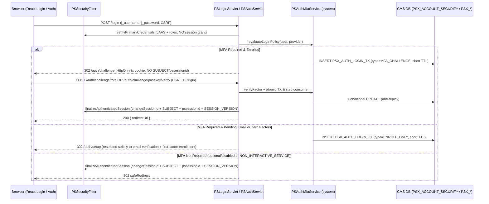

# Percussion CMS Login MFA and Account Recovery Plan

Require a **verified email address** for every human CMS account. For interactive CMS logins, require a password followed by either an **authenticator app code (TOTP)** or a **passkey (WebAuthn)**. Users can enroll both and use either at sign-in, and single-use **recovery codes** are issued after enrollment as a fallback. This plan treats the passkey as a second factor after password verification; passwordless sign-in is a separate product decision.

> **Scope & Status:** This revision incorporates the 2026-11-18 feasibility audit against Percussion CMS 8.2 (Java 21, Spring 7.0.10, Hibernate 7.4.13, Jetty 12.1.11 / Jakarta EE 11, Jackson 3.2.3, React 19.3.1, TypeScript 7.0.2, Vite 8.3.5, Node 22.22.0) and locks in all library selections, schema contracts, authentication boundary controls, and phased milestones.

## Locked Design Decisions

| Decision Area | Locked Choice | Rationale |
|---|---|---|
| **Transactional Auth Mail Config** | Dedicated `auth.mail.*` keys in `server.properties` with optional fallback (`auth.mail.fallbackWorkflowSmtp=true`) to `rxworkflow.properties` `SMTP_*` keys | Isolates auth mail from workflow `ENABLE_TEST_RUN_MODE` logging (which would leak reset/verification links into `notifications.log`) while minimizing operator re-configuration. |
| **Endpoint Rate Limiting** | `com.bucket4j:bucket4j_jdk17-core` (`8.22.0`, Apache-2.0) for per-IP / per-email burst throttling, paired with DB-backed per-account failure counters and lockouts | Zero transitive dependencies, JDK 17+ native, Apache-2.0 compatible; DB lockout state persists across restarts and cluster nodes. |
| **Server-Side Password Policy** | Configurable `auth.password.minLength` defaulting to **12** characters (hard ceiling **150** matching `PSBackEndTableProvider`) enforced uniformly across create, change, and reset flows | Closes the gap where `MIN_PASSWORD_LENGTH = 6` only lived in client TypeScript (`userPasswordApi.ts`) while keeping alignment with `PSBackEndTableProvider` clear-text bounds. |
| **Rollout & QA Default** | Default `auth.mfa.mode=optional` on fresh dev/QA installs; cohort-based production enforcement (`disabled` \| `optional` \| `cohort` \| `required`) | Keeps existing Playwright `@smoke` login tests green during rollout while enabling strict cohort/global enforcement after remediation. |

---

## 1. Selected Libraries (Java 21 & React 19)

All dependencies below are vetted against Percussion CMS 8.2's runtime constraints, Maven Enforcer rules (`requireUpperBoundDeps`, `dependencyConvergence`, `banDuplicatePomDependencyVersions` in [pom.xml](../../../pom.xml)), React 19 peer dependencies, Node `v22.22.0` (`frontend-maven-plugin` in [WebUI/pom.xml](../../../WebUI/pom.xml)), and **Apache-2.0** product licensing.

### 1.1 Java Backend Libraries

Manage versions in root [pom.xml](../../../pom.xml) `<dependencyManagement>` and declare in [system/pom.xml](../../../system/pom.xml) so auth/MFA core logic sits at the `system` layer beneath `rest`, `WebUI`, and `projects/sitemanage`.

| Capability | Maven Coordinates | Version | License | Role & Integration Notes |
|---|---|---|---|---|
| **WebAuthn / FIDO2 Server** | `com.webauthn4j:webauthn4j-core` + `tools.jackson.dataformat:jackson-dataformat-cbor` | `0.32.0.RELEASE` / `${jackson.version}` (`3.2.3`) | Apache-2.0 | **New.** WebAuthn4J 0.31+/0.32+ uses **Jackson 3 (`tools.jackson`)** natively, matching Percussion's `3.2.3` product JSON stack (whereas `com.yubico:webauthn-server-core:2.10.1` remains on legacy Jackson 2 `com.fasterxml.jackson`). Full WebAuthn L2/L3 and synced-passkey (`BE`/`BS` flags, `signCount == 0`) support. Pin `webauthn4j-core`, `jackson-dataformat-cbor` (`3.2.3`), and transitive `org.apache.kerby:kerby-asn1` (Apache-2.0) in root `<dependencyManagement>` to satisfy Maven Enforcer convergence. |
| **TOTP (RFC 6238 / 4226)** | `com.eatthepath:java-otp` | `1.0.0` | MIT | **New.** Zero runtime transitive dependencies (zero Enforcer risk), thread-safe, standard JCA `HmacSHA1`/`HmacSHA256`/`HmacSHA512`. Pair with already-managed `commons-codec` (`1.22.1`) `Base32` and a small `otpauth://` URI builder. |
| **Endpoint Rate Limiting** | `com.bucket4j:bucket4j_jdk17-core` | `8.22.0` | Apache-2.0 | **New.** Zero transitive dependencies, JDK 17+ native token-bucket throttling for public `/auth/*` and profile security endpoints (per-IP and per-account/email keys). Per-account failed MFA attempt counters and lockouts remain DB-backed. |
| **Transactional Outbound Mail** | `jakarta.mail:jakarta.mail-api` (`2.1.5`), `com.sun.mail:jakarta.mail` (`2.0.2`), `org.apache.commons:commons-email2-jakarta` (`2.0.0-M1`) | Existing | EPL-2.0 / Apache-2.0 | **Already managed.** Wire directly in a synchronous, observable `PSAuthMailService` instead of the async JMS workflow queue or event bus. |
| **TOTP Secret Encryption** | `PSEncryptor` / `PSAESGCMEncryptor` (`modules/perc-security-utils`) + JDK 21 JCA `AES/GCM/NoPadding` | Existing | Apache-2.0 | **Already present.** Reuse instance key material (`rxconfig/secure/.key`) with per-secret random 96-bit IV, GCM AAD bound to `ACCOUNT_ID`, and `KEY_VERSION` tracking. |
| **Token & Recovery Code Hashing** | JDK 21 `MessageDigest` (`SHA-256`, `MessageDigest.isEqual`), `SecretKeyFactory` (`PBKDF2WithHmacSHA256`), `org.bouncycastle:bcprov-jdk18on` (`1.85` `Argon2BytesGenerator`) | Existing | Apache-2.0 / MIT-like | **Already present.** Use `SHA-256` (or `HMAC-SHA-256`) for 256-bit opaque email tokens (enabling indexed lookup by hash) and Argon2id / PBKDF2-HMAC-SHA256 (≥210k iterations) with per-code random salt for 10-character Crockford Base32 recovery codes. Compare hashes in constant time via `MessageDigest.isEqual`. |
| **QR Code Rendering (Java)** | *None* | — | — | Not needed server-side (avoids `com.google.zxing` and headless AWT/ImageIO dependencies). Return `{ otpauthUri, manualSecret, issuer, accountName, digits, period }` over HTTPS and render SVG client-side. |

### 1.2 React / TypeScript Frontend Libraries

Add to [WebUI/src/main/frontend/package.json](../../../WebUI/src/main/frontend/package.json) (and regenerate `package-lock.json` for `frontend-maven-plugin` `npm ci` on Node `v22.22.0`), and mirror in [WebUI/package.json](../../../WebUI/package.json) so root `npm test` stays synchronized.

| Capability | npm Package | Version | License | Role & Integration Notes |
|---|---|---|---|---|
| **WebAuthn / Passkey Ceremony** | `@simplewebauthn/browser` | `^14.0.0` | MIT | **New.** Zero runtime dependencies (~5 KB gzipped), TypeScript-native, handles Base64URL ↔ `ArrayBuffer` conversion and WebAuthn L3 JSON matching WebAuthn4J, provides typed `WebAuthnError` handling and `browserSupportsWebAuthn()`. Requires Node ≥ 22 for build tooling (matches `WebUI/pom.xml` `<nodeVersion>v22.22.0</nodeVersion>`). |
| **TOTP QR Code SVG** | `qrcode.react` | `^4.2.0` | ISC (bundles MIT QR generator) | **New.** Zero runtime dependencies (~5–6 KB gzipped), explicit React 19 peerDependency support (`react@^19.3.1`), built-in TS types, renders inline `<QRCodeSVG>` compatible with strict CSP (`img-src` / no `data:` URI friction) and dark/light themes, paired with an accessible manual setup key. |
| **6-Digit TOTP Code Input** | *None (Native React/HTML)* | — | — | Native `<input type="text" inputMode="numeric" autoComplete="one-time-code" pattern="[0-9]*" maxLength={6} />` for accessibility, mobile/password-manager autofill, paste, and RTL support. |
| **Playwright E2E** | `@playwright/test` (`^1.64.1`) + Node `node:crypto` | Existing | Apache-2.0 | **Already present** in [modules/perc-qa-automation/frontend/package.json](../../../modules/perc-qa-automation/frontend/package.json). Use Chromium CDP virtual authenticator (`WebAuthn.enable` / `WebAuthn.addVirtualAuthenticator`) and a zero-dependency `node:crypto` RFC 6238 TOTP generator in E2E specs. |

---

## 2. Map and Harden the Authentication Boundary

### 2.1 Live Sign-In & Session Grant Inventory

Tracing [PSSecurityFilter.java](../../../system/src/main/java/com/percussion/servlets/PSSecurityFilter.java), [PSLoginServlet.java](../../../system/src/main/java/com/percussion/servlets/PSLoginServlet.java), [PSSecurityWs.java](../../../system/webservices/src/com/percussion/webservices/security/impl/PSSecurityWs.java), and [system-security-conf.xml](../../../WebUI/src/main/webapp/WEB-INF/config/security/system-security-conf.xml) reveals **five** distinct routes that currently issue or honor an authenticated CMS principal/session:

| # | Route / Mechanism | Current Code Path | Current Enforcement Gap | Target Policy & Gate |
|---|---|---|---|---|
| 1 | **Browser Form Login** (`POST /login`) | `PSLoginServlet.authenticate` → `PSSecurityFilter.authenticate` | Immediately sets `HttpSession.SUBJECT`, creates `PSUserSession`, sets `pssessionid` cookie, and redirects without rotating `JSESSIONID`. | Split primary credential verification from session finalization. Require MFA challenge or `ENROLL_ONLY` setup before minting `SUBJECT` / `pssessionid`; rotate `JSESSIONID` + `pssessionid` on completion. |
| 2 | **HTTP Basic Auth & Header Override** | `PSSecurityFilter.handleBasicAuth` for `/sys_login`, `/Design*`, `/rxwebdav*`, `/sys_webServicesHandler`, `/sys_reports/*`, `/rx_reports/*`, `/content/*`, **AND any URL carrying request header `sys_use_basic_auth`** (`PSSecurityFilter.java` line 916) | **Critical bypass:** sending `sys_use_basic_auth` + `Authorization: Basic ...` on *any* protected UI/REST endpoint currently calls `PSSecurityFilter.authenticate` directly without MFA. | Evaluate `PSAccountPolicy` after JAAS credential check. Reject Basic Auth (and block `sys_use_basic_auth`) with HTTP `401`/`403` for any human account subject to interactive MFA. Allow Basic Auth only for explicit `NON_INTERACTIVE_SERVICE` accounts (or legacy accounts while `auth.mfa.mode` is `disabled`/`optional`). |
| 3 | **SOAP Webservices Login** | `PSSecurityWs.login(...)` → `PSSecurityFilter.authenticate(...)` | Grants full `PSUserSession` via username/password only. | Enforce the same `PSAccountPolicy` check: reject password-only SOAP logins for MFA-enforced human accounts; permit `NON_INTERACTIVE_SERVICE` accounts with audited service policy. |
| 4 | **External / WebServer SSO Headers** | `PSSecurityFilter.handleExternalAuth` → `PSWebServerProvider` (`AUTH_TYPE` / `CERT_SUBJECT`) | Grants `SUBJECT` + `pssessionid` from trusted web server / client cert headers without checking CMS MFA policy. | Require explicit `SSO_EXTERNAL_MFA` policy (indicating upstream IdP/proxy enforces MFA) or trigger CMS MFA step-up before granting CMS session when an upstream provider does not assert MFA. |
| 5 | **Existing Session Rehydration** | `PSSecurityFilter.authorize` (`HttpSession.SUBJECT` at line 700, or `?pssessionid=...` via `handleExistingUserSession`) | `HttpSession.SUBJECT` is trusted *before* `PSUserSessionManager` is consulted, and `PSUserSessionManager` has no per-user revocation across sessions/nodes. | Stamp `SESSION_VERSION` (from `PSX_ACCOUNT_SECURITY`) into `HttpSession` and `PSUserSession`. Validate `SESSION_VERSION` in `PSSecurityFilter.handleAuthenticatedSubject` and `handleExistingUserSession`; add `PSUserSessionManager.releaseSessionsForUser(String)`. |

- **Legacy anonymous allowlist audit (Milestone 1):** [system-security-conf.xml](../../../WebUI/src/main/webapp/WEB-INF/config/security/system-security-conf.xml) and [Owasp.CsrfGuard.properties](../../../WebUI/src/main/webapp/WEB-INF/classes/Owasp.CsrfGuard.properties) allow `/v8/security/session` and `/v8/system/sites` anonymously, yet no `/v8/security/session` resource exists in `rest/`. Verify whether any legacy client depends on `/v8/*` routes and remove or explicitly lock down stale exceptions.
- **Unattended & system accounts:** Explicitly classify `rxserver`, `PercussionAdmin`, `rxpublisher`, and designated integration/publishing service accounts under `ACCOUNT_POLICY = NON_INTERACTIVE_SERVICE` (audited, excluded from interactive browser MFA, optionally scoped by IP/endpoint policy). Human interactive accounts must satisfy the same MFA assurance across every route that can grant CMS access.

### 2.2 CSRF Hardening & Reverse-Proxy Origin Validation

[Owasp.CsrfGuard.properties](../../../WebUI/src/main/webapp/WEB-INF/classes/Owasp.CsrfGuard.properties) currently sets `Ajax = false` and marks `/login`, `/services/*`, `/rest/*`, and `/Rhythmyx/*` as unprotected. Furthermore, `PSSecurityFilter.checkForCrossSiteRequestForgery()` (`line 689`) bypasses Referer/Origin validation whenever `requestBehindProxy=true` — which is the exact topology required for HTTPS WebAuthn deployments behind Nginx/Apache/ALB.

Therefore, **all state-changing endpoints under `/auth/*` and `/rest/...` / `/services/...` security routes must enforce defense-in-depth CSRF protection**:
1. Validate the session-bound `OWASP-CSRFTOKEN` header or form parameter (already emitted by [rxlogin.jsp](../../../WebUI/src/main/webapp/rxlogin.jsp) and read by [csrf.ts](../../../WebUI/src/main/ts/api/csrf.ts)). Ensure `/auth/challenge`, `/auth/setup`, `/auth/verify-email`, and `/auth/reset-password` pages inject CSRFGuard `<csrf:tokenname/>` / `<csrf:tokenvalue/>` into a fresh or transaction-bound `HttpSession`.
2. Enforce strict `Origin` (or `Sec-Fetch-Site` + `Referer` fallback) matching against configured `auth.publicBaseUrl` / `auth.webauthn.allowedOrigins` **even when `requestBehindProxy=true`**.
3. Unauthenticated public initiation requests (`/auth/forgot-username`, `/auth/forgot-password`) still validate `Origin`/`Sec-Fetch-Site` + `OWASP-CSRFTOKEN` (bound to the anonymous pre-login page session) and Bucket4j rate limits.

### 2.3 Security Boundary Split & Session Rotation

Refactor `PSSecurityFilter.authenticate` into two distinct primitives:
1. **`verifyPrimaryCredentials(HttpServletRequest, String uid, String pwd)`**: Executes JAAS `LoginContext` + `hasRhythmyxRole` check and returns the verified `Subject` and resolved canonical username without mutating `HttpSession.SUBJECT`, creating a `PSUserSession`, or emitting a `pssessionid` cookie.
2. **`finalizeAuthenticatedSession(HttpServletRequest, HttpServletResponse, Subject, String locale)`**:
   - Calls `request.changeSessionId()` to prevent session fixation.
   - Records the current `SESSION_VERSION` from `PSX_ACCOUNT_SECURITY` on the `HttpSession` and `PSUserSession`.
   - Sets `PSSecurityFilter.SUBJECT`, creates/updates `PSUserSession`, and emits `Set-Cookie: pssessionid=...; Path=/; HttpOnly; SameSite=...` (+ `Secure` when `request.isSecure()` or HTTPS proxy).

---

## 3. Module Architecture, Schema & Account Identity

### 3.1 Maven Module Layering

Root [pom.xml](../../../pom.xml) builds `modules/perc-security-utils` → `modules/perc-auditlog` → **`system`** → **`rest`** → **`WebUI`** → **`projects/sitemanage`** → `modules/perc-distribution-tree` → `modules/perc-qa-automation`.

- **`modules/perc-security-utils`**: Constant-time hash/token utilities; shared password policy constants/validator if needed below `system`.
- **`modules/perc-auditlog`**: New `AuthenticationErrorCodes` entries (MFA challenge/enroll/remove/lockout, recovery code used/regenerated, email verification staged/confirmed, password reset requested/completed, admin recovery granted/used) + [AuditRedactor.java](../../../modules/perc-auditlog/src/main/java/com/intsof/percussioncms/auditlog/redact/AuditRedactor.java) rules for `otpauth://` URIs, Base32 setup secrets, recovery codes, and verification/reset tokens.
- **`system`**: Core auth/MFA domain package (`com.percussion.services.auth.*`) containing Hibernate 7 `@Entity` classes, DAOs, `PSAccountSecurityService`, `PSTotpService` (`java-otp`), `PSPasskeyService` (`webauthn4j-core`), `PSRecoveryCodeService`, `PSAuthTokenService`, `PSAuthMailService` (`jakarta.mail` / `commons-email2-jakarta`), `PSAuthPolicyService`, `PSAuthRateLimiter` (`bucket4j`), and servlet/filter endpoints (`PSAuthServlet` mapped to `/auth/*` in [web.xml](../../../WebUI/src/main/webapp/WEB-INF/web.xml) + `PSLoginServlet` + `PSSecurityFilter`).
- **`rest`**: Authenticated profile security & admin readiness/recovery JAX-RS resources (`@PSSiteManageBean` + OpenAPI annotations), **plus mandatory Spring test stubs in `rest/src/test/...`** satisfying `rest` module classpath closure.
- **`projects/sitemanage`**: Apibridge adaptors bridging `rest` resources to `system` services, plus hardening `PSUserService` ([PSUserService.java](../../../projects/sitemanage/src/main/java/com/percussion/user/service/impl/PSUserService.java)) to enforce verified/required email rules and shared server-side password policy on user create/update/changepw.
- **`WebUI`**: React/TypeScript auth host (`rxauth.jsp` + `WebUI/src/main/ts/auth/`) and extensions to `ProfileShell.tsx` → `AccountSection.tsx` & `SecuritySection.tsx`, plus admin readiness/recovery UI.
- **`modules/perc-distribution-tree`**: Portable schema definitions in `cmsTableDef.xml` and default properties in `server.properties`.
- **`modules/perc-qa-automation` & `product-docs/8.2/`**: Playwright E2E coverage and operator/end-user documentation.

### 3.2 Relational Schema (`cmsTableDef.xml` + Hibernate 7)

Add six relational tables to [cmsTableDef.xml](../../../modules/perc-distribution-tree/src/main/resources/distribution/rxconfig/Installer/data/cmsTableDef.xml) using strictly portable JDBC column types (`VARCHAR`, `INTEGER`, `BIGINT`, `TIMESTAMP`, `CLOB` — compatible across H2, Derby, PostgreSQL, MySQL/MariaDB, MS SQL Server, and Oracle), following the `PSX_SYSTEM_AUDIT_LOG` pattern (`@Entity` under `com.percussion.*`, auto-scanned by `sys_sessionFactory` in [beans.xml](../../../WebUI/src/main/webapp/WEB-INF/config/spring/beans.xml) with `UpperCaseNamingStrategy`):

1. **`PSX_ACCOUNT_SECURITY`**
   - `ACCOUNT_ID` (`VARCHAR(36)` PK, immutable UUID)
   - `NORMALIZED_USERNAME` (`VARCHAR(255)` NOT NULL UNIQUE)
   - `SUBJECT_ID` (`INTEGER` NULL, cross-ref to `PSX_SUBJECTS.ID`)
   - `PROVIDER_TYPE` (`VARCHAR(32)` NOT NULL: `INTERNAL` \| `DIRECTORY` \| `SSO`)
   - `ACCOUNT_POLICY` (`VARCHAR(32)` NOT NULL: `INTERACTIVE_MFA_REQUIRED` \| `NON_INTERACTIVE_SERVICE` \| `SSO_EXTERNAL_MFA`)
   - `VERIFIED_EMAIL` (`VARCHAR(255)` NULL), `VERIFIED_EMAIL_NORM` (`VARCHAR(255)` NULL, indexed), `EMAIL_VERIFIED_AT` (`TIMESTAMP` NULL)
   - `PENDING_EMAIL` (`VARCHAR(255)` NULL)
   - `MFA_ENFORCEMENT_COHORT` (`VARCHAR(64)` NULL)
   - `SESSION_VERSION` (`BIGINT` NOT NULL DEFAULT 1)
   - `FAILED_MFA_ATTEMPTS` (`INTEGER` NOT NULL DEFAULT 0), `LOCKED_UNTIL` (`TIMESTAMP` NULL)
   - `CREATED_AT` (`TIMESTAMP` NOT NULL), `UPDATED_AT` (`TIMESTAMP` NOT NULL)
2. **`PSX_MFA_TOTP`**
   - `FACTOR_ID` (`VARCHAR(36)` PK), `ACCOUNT_ID` (`VARCHAR(36)` FK → `PSX_ACCOUNT_SECURITY`)
   - `SECRET_CIPHERTEXT` (`VARCHAR(512)` NOT NULL — AES-256-GCM with 96-bit random IV + `ACCOUNT_ID` AAD)
   - `KEY_VERSION` (`INTEGER` NOT NULL DEFAULT 1)
   - `ALGORITHM` (`VARCHAR(16)` NOT NULL DEFAULT `'HmacSHA1'`), `DIGITS` (`INTEGER` NOT NULL DEFAULT 6), `PERIOD_SECONDS` (`INTEGER` NOT NULL DEFAULT 30)
   - `STATUS` (`VARCHAR(16)` NOT NULL: `PENDING` \| `ACTIVE` \| `DISABLED`)
   - `LAST_ACCEPTED_STEP` (`BIGINT` NOT NULL DEFAULT -1 — updated atomically via `UPDATE PSX_MFA_TOTP SET LAST_ACCEPTED_STEP = :step, LAST_USED_AT = :now WHERE FACTOR_ID = :id AND STATUS = 'ACTIVE' AND LAST_ACCEPTED_STEP < :step`)
   - `ENROLLED_AT` (`TIMESTAMP` NULL), `LAST_USED_AT` (`TIMESTAMP` NULL)
3. **`PSX_MFA_PASSKEY`**
   - `PASSKEY_ID` (`VARCHAR(36)` PK), `ACCOUNT_ID` (`VARCHAR(36)` FK → `PSX_ACCOUNT_SECURITY`)
   - `CREDENTIAL_ID` (`VARCHAR(512)` NOT NULL UNIQUE — Base64URL)
   - `USER_HANDLE` (`VARCHAR(128)` NOT NULL — Base64URL random 32-byte handle per account)
   - `COSE_PUBLIC_KEY` (`CLOB` NOT NULL — Base64 CBOR COSE key)
   - `SIGN_COUNT` (`BIGINT` NOT NULL DEFAULT 0)
   - `BACKUP_ELIGIBLE` (`CHAR(1)` NOT NULL DEFAULT `'N'`), `BACKUP_STATE` (`CHAR(1)` NOT NULL DEFAULT `'N'`)
   - `TRANSPORTS` (`VARCHAR(255)` NULL), `DISPLAY_NAME` (`VARCHAR(120)` NOT NULL)
   - `CREATED_AT` (`TIMESTAMP` NOT NULL), `LAST_USED_AT` (`TIMESTAMP` NULL)
4. **`PSX_MFA_RECOVERY_CODE`**
   - `CODE_ID` (`VARCHAR(36)` PK), `ACCOUNT_ID` (`VARCHAR(36)` FK), `BATCH_ID` (`VARCHAR(36)` NOT NULL)
   - `CODE_HASH` (`VARCHAR(255)` NOT NULL)
   - `CONSUMED_AT` (`TIMESTAMP` NULL — consumed atomically via `UPDATE ... SET CONSUMED_AT = :now WHERE CODE_ID = :id AND CONSUMED_AT IS NULL`)
   - `CREATED_AT` (`TIMESTAMP` NOT NULL)
5. **`PSX_AUTH_TOKEN`**
   - `TOKEN_ID` (`VARCHAR(36)` PK), `ACCOUNT_ID` (`VARCHAR(36)` FK)
   - `PURPOSE` (`VARCHAR(32)` NOT NULL: `VERIFY_EMAIL` \| `CHANGE_EMAIL` \| `PASSWORD_RESET` \| `ADMIN_RECOVERY`)
   - `TOKEN_HASH` (`VARCHAR(128)` NOT NULL UNIQUE — SHA-256 hex/Base64URL of 256-bit random token)
   - `TARGET_EMAIL` (`VARCHAR(255)` NULL)
   - `EXPIRES_AT` (`TIMESTAMP` NOT NULL), `CONSUMED_AT` (`TIMESTAMP` NULL — atomic single-use `WHERE CONSUMED_AT IS NULL AND EXPIRES_AT > :now`)
   - `CREATED_AT` (`TIMESTAMP` NOT NULL), `REQUEST_IP` (`VARCHAR(64)` NULL)
6. **`PSX_AUTH_LOGIN_TX`**
   - `TX_ID` (`VARCHAR(64)` PK — random opaque ID bound to HttpOnly SameSite cookie)
   - `ACCOUNT_ID` (`VARCHAR(36)` FK), `TX_TYPE` (`VARCHAR(32)` NOT NULL: `MFA_CHALLENGE` \| `ENROLL_ONLY` \| `WEBAUTHN_CEREMONY` \| `STEP_UP`)
   - `CHALLENGE_B64` (`VARCHAR(128)` NULL — WebAuthn challenge bytes)
   - `REDIRECT_URL` (`VARCHAR(2048)` NULL), `LOCALE` (`VARCHAR(32)` NULL)
   - `EXPIRES_AT` (`TIMESTAMP` NOT NULL), `CONSUMED_AT` (`TIMESTAMP` NULL — atomic consumption)
   - `ATTEMPT_COUNT` (`INTEGER` NOT NULL DEFAULT 0), `CREATED_AT` (`TIMESTAMP` NOT NULL)

### 3.3 Stable Account Identity, Email Migration & Password Policy

- **Immutable `ACCOUNT_ID` binding:** `USERLOGIN` ([PSUserLogin.java](../../../projects/sitemanage/src/main/java/com/percussion/user/data/PSUserLogin.java)) keys on `USERID VARCHAR(50)` for internal accounts only, whereas [PSBackEndSubject.java](../../../system/services/src/com/percussion/services/security/data/PSBackEndSubject.java) has integer `ID` for both internal and directory subjects. `PSX_ACCOUNT_SECURITY.ACCOUNT_ID` (UUID) decouples all email verification, TOTP, passkeys, recovery codes, and tokens from mutable usernames or email strings.
- **Harden `sys_email` persistence:** Fix [PSBackEndRoleMgr.java](../../../system/services/src/com/percussion/services/security/impl/PSBackEndRoleMgr.java#L228-L245) `setSubjectEmail()` so persistence failures throw an exception instead of logging and silently succeeding.
- **Require email in create/update/import paths:**
  - `PSUserService.create()` (`INTERNAL` human accounts) requires a valid email address; stores it in `sys_email` and `PSX_ACCOUNT_SECURITY.PENDING_EMAIL`, sends a verification link, and restricts sign-in to `ENROLL_ONLY` setup until email verification and at least one MFA factor are complete.
  - `PercussionAdmin` (created with blank email in `PSUserService.createPercussionUser()`) and `rxserver` follow explicit `NON_INTERACTIVE_SERVICE` policy unless promoted/configured by an operator.
  - Directory-managed accounts (`PSUserProviderType.DIRECTORY`) reject local email edits in `PSUserService.updateMyAccount()` as today, load `sys_email` from the directory cataloger, and record how upstream address changes re-trigger verification unless an explicit trusted-directory-email claim setting (`auth.directory.trustEmailVerified=false` default) is configured.
- **Staged email changes:** Changing a verified email in `AccountSection.tsx` / `/profile` requires recent step-up MFA (within 5 minutes), keeps `VERIFIED_EMAIL` active until the replacement address confirms its `CHANGE_EMAIL` token, and emails a security notice to the previous verified address.
- **Required vs. unique email & readiness report:** Produce an administrator **Account Readiness Report** (`GET /rest/auth/admin/readiness` or `/services/...` admin endpoint + Admin UI panel) flagging:
  1. Missing, malformed, duplicate (case-insensitive normalized), and unverified `sys_email` values.
  2. Accounts without any enrolled MFA factor.
  3. Infrastructure readiness: outbound SMTP configuration + live test send, `auth.publicBaseUrl` validity, `auth.webauthn.rpId` / `allowedOrigins` HTTPS validation, and `rxconfig/secure/.key` cluster key-fingerprint check.
  - **Required email and unique email remain separate settings** (`auth.email.required`, `auth.email.uniqueForRecovery`). Recovery tokens are always bound to a specific `ACCOUNT_ID`. Ambiguous shared addresses block self-service email-based forgot-password lookup for affected accounts until resolved by an admin.
  - Existing unverified `sys_email` values are **never** auto-promoted to `VERIFIED_EMAIL` on upgrade; users complete an admin-controlled verification/enrollment window, and accounts with missing contact info require an audited operator identity check before setting a verified address.
- **Shared server-side password policy:** Enforce `auth.password.minLength` (default `12`, max `150` per `PSBackEndTableProvider`) in a central `PSPasswordPolicyValidator` called by `PSUserService.create`, `PSUserService.update`, `PSUserService.changePassword`, and password reset. Upgrade [PSPasswordHandler.java](../../../modules/perc-security-utils/src/main/java/com/percussion/security/PSPasswordHandler.java) hash comparison to constant-time `MessageDigest.isEqual`.

---

## 4. Configuration (`server.properties` & Cluster Key Management)

Add documented properties to [server.properties](../../../system/config/server.properties) (and installer templates):

```properties
# --- Authentication, MFA & Account Recovery ---
# disabled | optional | cohort | required
auth.mfa.mode=optional
auth.mfa.requiredCohorts=
auth.email.required=true
auth.email.uniqueForRecovery=false
auth.directory.trustEmailVerified=false
auth.password.minLength=12

# Public external base URL (scheme + host + optional port + context path, e.g. https://cms.example.com/Rhythmyx)
auth.publicBaseUrl=

# WebAuthn / Passkeys (HTTPS required except http://localhost dev)
auth.webauthn.rpId=
auth.webauthn.rpName=Percussion CMS
auth.webauthn.allowedOrigins=

# Synchronous transactional auth mail (does NOT honor workflow ENABLE_TEST_RUN_MODE)
auth.mail.host=
auth.mail.port=587
auth.mail.username=
auth.mail.password=
auth.mail.starttls=true
auth.mail.sslPort=
auth.mail.from=
auth.mail.bounceAddress=
# Optional fallback to rxconfig/Workflow/rxworkflow.properties SMTP_* keys when auth.mail.host is blank
auth.mail.fallbackWorkflowSmtp=true
```

> **Cluster Encryption Key Note:** [PSEncryptor.java](../../../modules/perc-security-utils/src/main/java/com/percussion/security/PSEncryptor.java) stores the AES-GCM instance key on disk at `rxconfig/secure/.key`. In multi-node CMS deployments, all nodes **must** share the same `.key` file so any node can decrypt `PSX_MFA_TOTP.SECRET_CIPHERTEXT`. The readiness report exposes a non-secret SHA-256 key fingerprint prefix so operators can confirm node parity.

---

## 5. Two-Factor Sign-In, Auth Mail, Recovery & React UI

### 5.1 Sign-In & Enrollment Flow



### 5.2 Factor Behaviors

| Method | Enrollment, Storage & Sign-In Rules |
|---|---|
| **Authenticator App (TOTP)** | Generate 160-bit CSPRNG secret (`eatthepath/java-otp` + `commons-codec` Base32, 6 digits, 30s period, `HmacSHA1`). Return `otpauthUri` + manual Base32 key over HTTPS; render inline `<QRCodeSVG>` via `qrcode.react`. Require valid first TOTP code (±1 step tolerance) before setting `STATUS=ACTIVE`. Encrypt secret at rest with AES-256-GCM (`accountId` AAD + `KEY_VERSION`). Rate-limit attempts, lock out after threshold, and atomically reject reuse via `WHERE LAST_ACCEPTED_STEP < :step`. |
| **Passkey (WebAuthn)** | Use `com.webauthn4j:webauthn4j-core` (`0.32.0.RELEASE`) on server and `@simplewebauthn/browser` (`^14.0.0`) on client. Require HTTPS origin (`http://localhost` allowed only in local dev) matching `auth.webauthn.rpId` & `allowedOrigins`. Require `userVerification = REQUIRED` (challenge) / `PREFERRED` or `REQUIRED` (registration per policy). Store `CREDENTIAL_ID`, `USER_HANDLE`, `COSE_PUBLIC_KEY`, `SIGN_COUNT`, `BACKUP_ELIGIBLE`, `BACKUP_STATE`, and user-chosen `DISPLAY_NAME`. Handle synced passkeys cleanly (`signCount == 0` permitted when previous `signCount == 0`; strictly enforce `> stored` when authenticator increments counters). Allow multiple named passkeys per account. |
| **Recovery Codes** | Issue 10 single-use codes (10-char Crockford Base32) upon initial MFA enrollment; display once in React UI with copy/download actions; store only salted Argon2id/PBKDF2 hashes in `PSX_MFA_RECOVERY_CODE`. Consuming a code (after valid password) atomically sets `CONSUMED_AT` (`WHERE CONSUMED_AT IS NULL`) and succeeds sign-in (with prompt to replace lost factor). Regenerating codes requires recent step-up MFA and invalidates all unused codes in prior batches. |

### 5.3 Synchronous Transactional Mail (`PSAuthMailService`)

- **Replaces erroneous [PSNotificationService.java](../../../system/services/src/com/percussion/services/notification/impl/PSNotificationService.java) reference in draft v1:** `PSNotificationService` is an in-JVM listener bus, and existing workflow mail ([PSEmailMessageHandler.java](../../../system/services/src/com/percussion/services/system/impl/PSEmailMessageHandler.java) → [PSSecureMailProgram.java](../../../modules/extensions-workflow/src/main/java/com/percussion/workflow/mail/PSSecureMailProgram.java)) is async JMS that swallows `EmailException` and logs plain bodies under `ENABLE_TEST_RUN_MODE`.
- Implement **`PSAuthMailService`** in `system` using `org.apache.commons.mail2.jakarta.HtmlEmail` / `SimpleEmail` (`jakarta.mail`), configured from `auth.mail.*` (with optional fallback to `rxworkflow.properties` SMTP host/port/creds only — **never** `ENABLE_TEST_RUN_MODE`), strict TLS server-identity check, explicit send timeout, synchronous failure propagation/metrics (never returning tokens in HTTP errors), and full redaction of links/tokens/secrets from logs.

### 5.4 Verification & Account Recovery Flows

| Flow | Endpoint & User Experience | Security & Server Behavior |
|---|---|---|
| **Verify Email** | Confirmation page at `/auth/verify-email?token=...` (link generated from `auth.publicBaseUrl`) + throttled resend action | Purpose-bound 256-bit random token (`VERIFY_EMAIL` or `CHANGE_EMAIL`), SHA-256 hashed in `PSX_AUTH_TOKEN`, short TTL (e.g., 24h for verify, 1h for email change). `GET` renders confirmation button only; `POST` consumes token atomically (`WHERE CONSUMED_AT IS NULL`) so email link-scanners cannot auto-verify. |
| **Forgot Username** | Public page `/auth/forgot-username` (linked from React `LoginPage.tsx`) | Accepts email address; protected by Bucket4j rate limit + CSRF/Origin check. Always returns identical generic acknowledgment. Sends username reminder **only** to `VERIFIED_EMAIL` matching the deployment's ownership policy (`auth.email.uniqueForRecovery`); never leaks usernames in HTTP response. |
| **Forgot Password** | Public page `/auth/forgot-password` + `/auth/reset-password?token=...` | Accepts username or unambiguous `VERIFIED_EMAIL`. Returns identical generic acknowledgment. Sends short-lived (e.g., 30 min) single-use `PASSWORD_RESET` link for `INTERNAL` accounts; for `DIRECTORY` / `SSO` accounts, sends/displays guidance directing the user to their owning directory/IdP recovery process. Writing the new password uses `PSPasswordPolicyValidator` + `IPSPasswordFilter` (`USERLOGIN`), increments `SESSION_VERSION`, invokes `PSUserSessionManager.releaseSessionsForUser`, invalidates outstanding reset tokens, **preserves enrolled MFA factors**, and requires fresh login + MFA. |
| **Lost Factors / Break-Glass Recovery** | Admin UI action + audited token flow (`/auth/admin-recovery`) + documented CLI/operator runbook | Requires Admin role + recent step-up MFA + identity verification note. Issues time-limited `ADMIN_RECOVERY` action (or temporary `ENROLL_ONLY` reset) logged to `PSX_SYSTEM_AUDIT_LOG`. Password reset alone never bypasses MFA. Document and test **last-administrator lockout recovery** runbook before enabling `required` enforcement. |

### 5.5 React UI Integration

1. **Dedicated unauthenticated auth host (`/auth/*` → `rxauth.jsp` + `WebUI/src/main/ts/auth/`):**
   - Keeps custom customer `user/login.jsp` overrides ([PSLoginServlet.java](../../../system/src/main/java/com/percussion/servlets/PSLoginServlet.java#L588-L597)) untouched for primary username/password entry while always handling `/auth/challenge`, `/auth/setup`, `/auth/verify-email`, `/auth/forgot-username`, `/auth/forgot-password`, and `/auth/reset-password` via Percussion's React bundle.
   - Uses a dedicated auth fetch client (NOT [client.ts](../../../WebUI/src/main/ts/api/client.ts), because `client.ts` treats `401` and `/login` redirects as fatal mid-session expiry and forces browser navigation).
   - Add unobtrusive "Forgot username?" / "Forgot password?" links to [LoginPage.tsx](../../../WebUI/src/main/ts/login/LoginPage.tsx) (honoring TMX i18n keys and `dir="rtl"`).
2. **Profile Hub extensions ([ProfileShell.tsx](../../../WebUI/src/main/ts/profile/ProfileShell.tsx)):**
   - Extend [AccountSection.tsx](../../../WebUI/src/main/ts/profile/AccountSection.tsx) to show verified vs. pending email status, resend verification action, and step-up MFA prompt when changing email.
   - Extend [SecuritySection.tsx](../../../WebUI/src/main/ts/profile/SecuritySection.tsx) alongside the existing password-change form with TOTP enrollment/disable (`qrcode.react` `<QRCodeSVG>` + manual key), multi-passkey registration/rename/removal (`@simplewebauthn/browser`), recovery-code generation/count, step-up MFA gate, and guard preventing removal of the last usable factor while MFA is required.

---

## 6. Phased Implementation Milestones & Verification Plan

### Milestone 1 — Inventory, Dependencies, Schema, Auth Mail & Readiness Report
- **Deliverables:**
  1. Complete sign-in route & legacy endpoint audit (including `/v8/security/session` & `/v8/system/sites` disposition) and security-provider ownership matrix (`BackEndTable`, `Directory`/`JNDI`, `WebServer`, system/service accounts).
  2. Pin `webauthn4j-core` (`0.32.0.RELEASE`), `jackson-dataformat-cbor` (`3.2.3`), `kerby-asn1`, `java-otp` (`1.0.0`), `bucket4j_jdk17-core` (`8.22.0`) in root [pom.xml](../../../pom.xml) + [system/pom.xml](../../../system/pom.xml); add `@simplewebauthn/browser` (`^14.0.0`) & `qrcode.react` (`^4.2.0`) to both WebUI `package.json` files + regenerate `package-lock.json`.
  3. Add the 6 tables to [cmsTableDef.xml](../../../modules/perc-distribution-tree/src/main/resources/distribution/rxconfig/Installer/data/cmsTableDef.xml), Hibernate 7 `@Entity` models + DAOs in `system`, and `server.properties` defaults.
  4. Implement `PSAuthMailService` (synchronous Jakarta Mail) and admin Readiness Report service/API/UI (missing/malformed/duplicate/unverified emails, factor coverage, SMTP live check, `auth.publicBaseUrl`, WebAuthn origins, cluster `.key` fingerprint).
- **Gate:** Standalone JDK 21 `./mvnw clean install` green in `system`, `rest`, `WebUI`, `projects/sitemanage`, `modules/perc-distribution-tree`; Maven Enforcer passes; fresh & upgrade DB schema tests pass.

### Milestone 2 — Verified Email Lifecycle & Forgot Username
- **Deliverables:** Harden `PSBackEndRoleMgr.setSubjectEmail`; add `PSAccountSecurityService` + `PSAuthTokenService`; enforce email requirement & `ENROLL_ONLY` gating in `PSUserService` create/update/import; implement `/auth/verify-email` confirmation page (`GET` confirm UI, `POST` atomic consume) and `/auth/forgot-username`; extend `AccountSection.tsx`.
- **Gate:** Unit + integration tests for email verification, email scanner `GET`-safety, staged email change (with old-address notice), and enumeration-safe forgot-username.

### Milestone 3 — Security Boundary Split, CSRF/Session Hardening & TOTP + Recovery Codes
- **Deliverables:** Refactor `PSSecurityFilter` (`verifyPrimaryCredentials` vs. `finalizeAuthenticatedSession`), close `sys_use_basic_auth` bypass and enforce policy in `PSSecurityWs.login`, add strict `OWASP-CSRFTOKEN` + `Origin` validation behind proxy, implement `request.changeSessionId()` + `SESSION_VERSION` validation + `PSUserSessionManager.releaseSessionsForUser`, implement `PSTotpService` (`java-otp` + AES-256-GCM + atomic `LAST_ACCEPTED_STEP`) + `PSRecoveryCodeService`, `/auth/challenge` & `/auth/setup` UI, `SecuritySection.tsx` TOTP + recovery codes + step-up MFA, and `perc-auditlog` codes + `AuditRedactor` updates.
- **Gate:** Server security-boundary tests proving password-only `TX_ID` cannot access protected UI/REST/legacy endpoints; concurrent TOTP step & recovery-code replay tests; WebUI Vitest tests.

### Milestone 4 — Passkeys (WebAuthn)
- **Deliverables:** Implement `PSPasskeyService` (`webauthn4j-core`), `/auth/challenge/passkey/*` and profile `/rest/auth/mfa/passkeys/*` endpoints (with `rest/src/test/...` Spring test stubs + `sitemanage` apibridge adaptors), multi-passkey UI in `SecuritySection.tsx` and challenge sign-in via `@simplewebauthn/browser`, synced passkey support, and last-factor deletion guard.
- **Gate:** WebAuthn4J ceremony verification tests (including origin/RP-ID mismatch, signature tampering, challenge replay, sign-count regression), `rest` full module build green, Vitest green.

### Milestone 5 — Forgot Password Reset, Password Policy & Admin Break-Glass Recovery
- **Deliverables:** Implement `PSPasswordPolicyValidator` (`auth.password.minLength=12`, max 150) across `PSUserService` & reset; implement `/auth/forgot-password` & `/auth/reset-password` (atomic single-use reset, `SESSION_VERSION` bump revoking all sessions, preserving MFA factors, directory/SSO redirect messaging); implement audited Admin break-glass recovery & document last-admin recovery runbook.
- **Gate:** Integration tests proving active sessions (both `HttpSession` and `pssessionid`) fail immediately post-reset, enrolled TOTP/passkeys survive reset, and concurrent reset token consumption allows only one winner.

### Milestone 6 — End-to-End QA, Product Docs & Cohort Enforcement Rollout
- **Deliverables:**
  1. Playwright specs in `modules/perc-qa-automation` covering TOTP enrollment/challenge, Passkey enrollment/challenge via Chromium CDP virtual authenticator (`WebAuthn.addVirtualAuthenticator`), staged email change, and password reset (while existing `@smoke` suite stays green under default `auth.mfa.mode=optional`).
  2. Operator & end-user documentation under `product-docs/8.2/` (MFA enrollment, passkeys, recovery codes, SMTP/public URL/WebAuthn configuration, cohort rollout, break-glass & last-admin recovery, rollback procedure).
  3. Pilot cohort validation & audited rollout checklist.
- **Gate:** Full standalone JDK 21 `./mvnw clean install` in every changed module, Vitest suite, Playwright QA specs, and `scripts/ci-smoke-product-docs.sh` (or `.bat`) all pass.

---

## 7. Verification Command Reference

```bash
# 1. Java module builds & Enforcer convergence (standalone JDK 21 in each changed module)
cd modules/perc-auditlog && ../../mvnw clean install
cd ../../system && ../mvnw clean install
cd ../rest && ../mvnw clean install
cd ../WebUI && ../mvnw clean install
cd ../projects/sitemanage && ../../mvnw clean install
cd ../../modules/perc-distribution-tree && ../../mvnw clean install

# 2. WebUI React/TS build & Vitest suite
cd WebUI/src/main/frontend && npm ci && npm run build:modern && npm test
cd ../.. && npm test

# 3. Playwright E2E (with Chromium CDP virtual authenticator specs)
cd modules/perc-qa-automation/frontend && npm test

# 4. Product documentation smoke check
./scripts/ci-smoke-product-docs.sh
```
