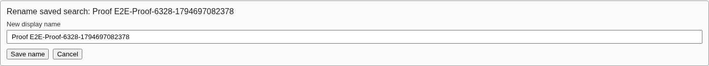

# QA record — Saved-search manage dialog a11y gate (issue #6328)

Date (UTC): 2026-11-14
Executed by: night-issue-prs work agent (OpenCode, muse-spark-1.3-contributor)
Parent: #6109 (program #4530 — i18n/a11y per-slice gate compliance sampling)
Merged PR under test: #6300
(`test(qa): manage-dialog a11y gate in explorer-saved-search-manage spec (#6180)`)
Playwright spec:
`modules/perc-qa-automation/frontend/tests/explorer-saved-search-manage.spec.js`
Result: **CONDITIONAL PASS — automated gates green (5 passed, axe clean,
keyboard traversal executed); 2 observations below for human sign-off.
Issue stays open.**

## Keyboard walk (executed 2026-11-14 on the same cell)

Rename Manage dialog opened on a throwaway saved search; Tab × 8 from the
Rename button, Shift+Tab × 1, then Escape (Playwright `page.keyboard`):

Tab order (activeElement after each Tab):

1. `BUTTON[search-panel-saved-rename]` "Rename saved search"
2. `BUTTON[search-panel-saved-delete]` "Delete saved search"
3. `INPUT[search-panel-saved-rename-input]` (prefilled with current label)
4. `BUTTON[search-panel-saved-rename-save]` "Save name"
5. `BUTTON[search-panel-saved-manage-cancel]` "Cancel"
6. → focus leaves the dialog to background page chrome (footer
   "Intersoft Data Labs" link, `BODY`, nav `Home` link …)

Shift+Tab from the nav link returns one step (symmetric). Dialog chrome:
`role="dialog" aria-modal="true" aria-label="Rename saved search"`.

Observations for human sign-off (not axe failures — spec stays green):

- **O1 — Escape does not dismiss the dialog** (`escapeClosed: false`;
  Cancel click closes it and REST confirms the label unchanged). WAI-ARIA
  dialog guidance recommends Escape-to-dismiss; axe does not fail it.
- **O2 — focus is not trapped**: after Cancel, Tab continues into the
  background page chrome behind the `aria-modal` dialog. Sane order, but a
  strict modal would cycle within the dialog.

Neither observation is a serious a11y violation per the axe
serious+critical gate; both are recorded here so the human sign-off walk
can disposition them.

## Environment

- Fresh CMS-only H2 QA cell from `python docker/scripts/perc-devctl.py qa-up`
  (branch tip = `origin/main`; no product code changed by this QA ticket, so no
  hot-deploy — cell runs the merged product route).
- `qa-health`: `RESULT:OK … HTTP:200 HEALTH:healthy` on
  `/Rhythmyx/rest/mimetypes`.
- `TEST_CMS_URL=http://127.0.0.1:9993` (freeport contract).

## Test-plan mapping (issue #6328)

| # | QA step | Automated equivalent | Result |
|---|---------|----------------------|--------|
| 1 | Run `npm run test:surface -- --path tests/explorer-saved-search-manage.spec.js` and confirm 5 passed, zero console errors | 5 passed (10.3s), exit 0; every test asserts `pageErrors` empty (zero `pageerror` / console `error` events in-spec) | PASS |
| 2 | In the Explorer UI open Saved Search → Manage dialog; keyboard-walk (Tab / Shift+Tab / Escape) and confirm focus order is sane and no serious a11y violations surface | `rename and delete dialogs have zero serious a11y violations`: `expectNoSeriousA11yViolations` (axe, serious+critical) run against the open rename dialog and the open delete dialog; both green. Live-proof screenshot of the open rename dialog committed at `docs/ai-generated/proofs/issue-6328-saved-search-manage.png` shows labelled input + Save name / Cancel buttons. **Keyboard walk executed** (see section above): Tab order sane through input → Save → Cancel; O1 Escape does not dismiss; O2 focus not trapped | CONDITIONAL PASS (axe green + traversal executed; O1/O2 pending human disposition, issue left open) |
| 3 | Confirm dialog Cancel/close leaves saved searches unchanged | `rename cancel keeps the row and writes nothing` (REST label unchanged after Cancel) and `delete cancel keeps the row and deletes nothing` (row still in picker + REST after Cancel) | PASS |

Out of scope (per issue): saved-search CRUD behavior itself; non-manage-dialog
Explorer surfaces.

## Spec output (same cell)

- `npm run test:surface -- --path tests/explorer-saved-search-manage.spec.js` →
  **5 passed (10.3s)**, 0 skipped, exit 0; zero `pageerror` / console `error`
  events in-spec.
- Baseline `tests/golden-unattended-smoke.spec.js` → **2 passed (1.8s)**
  (env resolve + Admin login + Explorer shell) on the same cell.

## server.log note

Zero `ERROR` / zero `FATAL` in
`/opt/Percussion/jetty/base/logs/server.log` for the whole cell lifetime
(installer bootstrap through both spec runs) — cleaner than the
pre-existing Hibernate-noise baseline noted in #6328.

## Live proof

Open rename Manage dialog: labelled "New display name" input prefilled with
the saved-search label, Save name / Cancel buttons. Cancel verified by spec to
close the dialog and write nothing (step 3).
